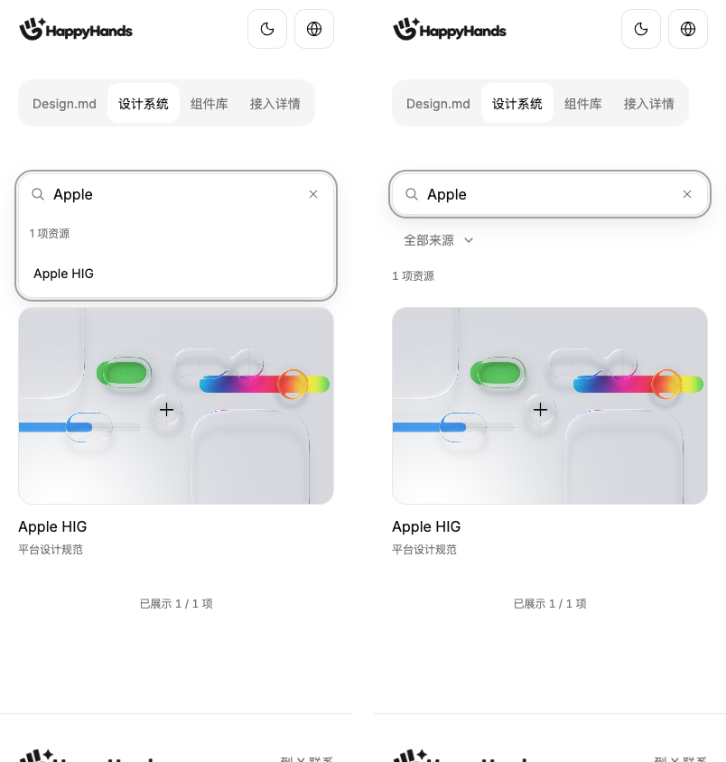

# PR81 Harness review

Status: independent model review pending. Not human acceptance or release approval.

Run `80ae9c66`, source baseline `9710804042fbd9526b397714740b8dfe9824ee7e`. This continues the retained incomplete intake `2659296e`; it does not erase failed captures or model attempts.

## Confirmed repair

The actual sequence Apple search → ArrowDown → Escape returned focus but reopened suggestions at both1440px and390px. Harness diagnosis admitted one functional finding, `MODEL-f42dab33f4fa-1`. Its isolated executor changed only shared search focus/state handling and added focused event-order tests. Escape now dismisses after returning focus; pointer and ArrowDown can reopen the panel. The query and filtered resources remain intact.

These are unmodified source screenshots composed by Harness. Remote thumbnail loading may differ between interaction captures; full-page platform covers were captured separately. The comparison is not a human acceptance record.

## Evidence and verification

- Fourteen before and fourteen after states reached: systems, Apple HIG, Quartz, component directory, search open/Escape and downloads, at1440×900 and390×844.
- Actual project UI rules, component contracts, selected Luma preset and shared control/navigation styles are hash-bound. Public-page web-taste, OJO, Impeccable and own remediation methods are staged in the Run.
- Bound browser verification passed12 checks: search dismissal/focus, keyboard reopening/Enter, component-consumer dismissal/pointer reopening, platform topics/empty/return, detail tabs, theme and containment at both widths. Browser page errors:0.
- TypeScript and3 event-order tests passed after generating the isolated checkout's preview assets. The event tests explicitly do not replace React/browser verification.
- Source/catalog tests: specimen/platform grouping5, directory6, collections4, design resources5, archive28, hosted registry3, plus portal tests passed.
- Supplemental presentation regression:18 list/detail combinations covering390/768/1440, Chinese/light and English/dark passed with a corrected layout assertion. Different facet counts legitimately wrap; compare equal toolbar-to-card gaps and gutters, not absolute card Y across providers.

## Preserved limitations

- Initial capture definitions missed the explicit plan or used an ambiguous search label. All failed intake records remain local; no failure was marked passed.
- Remote Apple cover needed normal scroll/hover settling before whole-page capture. The asset loaded successfully; no invented replacement was introduced.
- Codex CLI0.141 rejected the configured model. CLI0.169 was installed and selected explicitly; configured gpt-6-astra was retained. No failed model call was treated as review success.
- Executor browser startup was denied by its environment; full browser verification was subsequently performed and bound through Harness in the host environment.
- No physical iPhone or native Safari certification in this Run. Third-party previews retain their own designs; this is not blanket accessibility certification or inspection of every possible archived component interaction.
- Missing h1 was retained as a semantic improvement hypothesis, not admitted as a demonstrated functional defect. The approved visible layout was preserved.
- Static UI lint's2px focus-outline finding is a false positive under the explicit project focus-visibility rule; focus outlines were retained.
